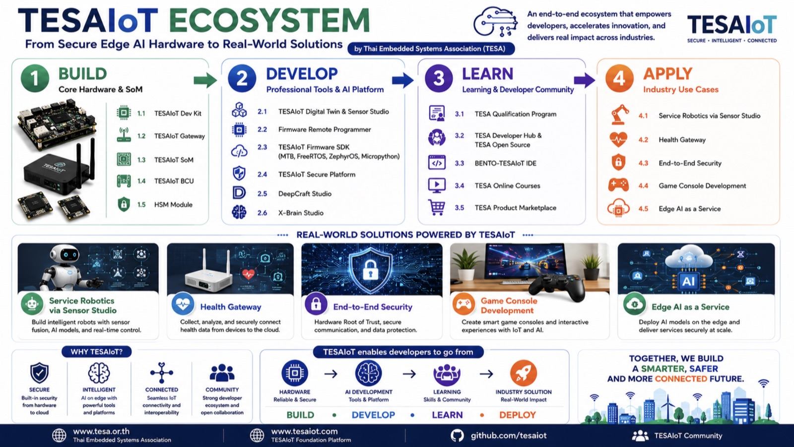
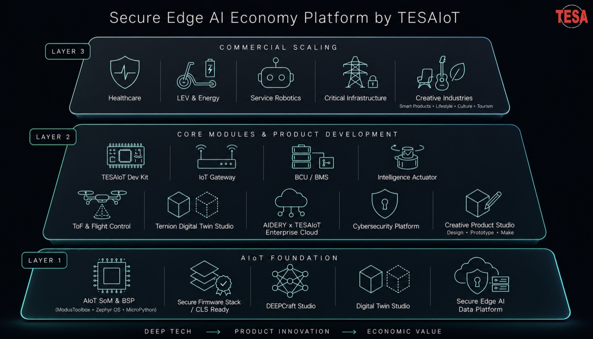
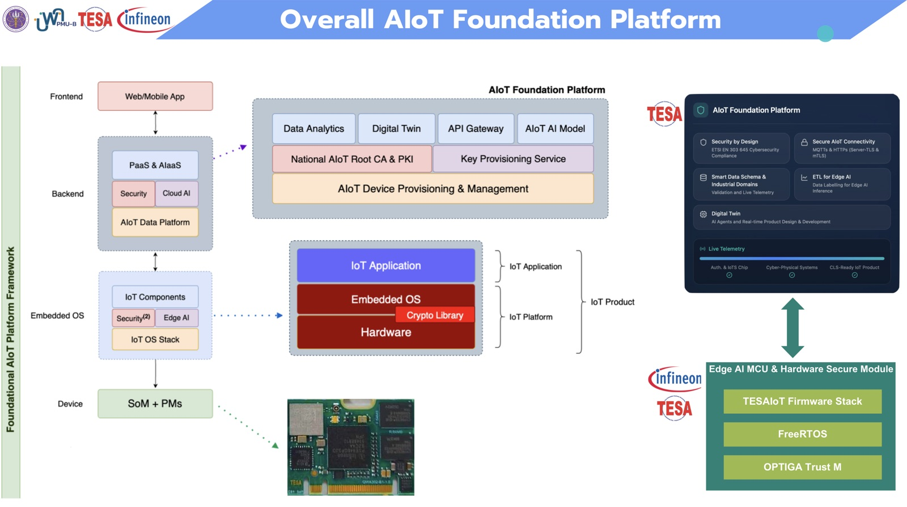
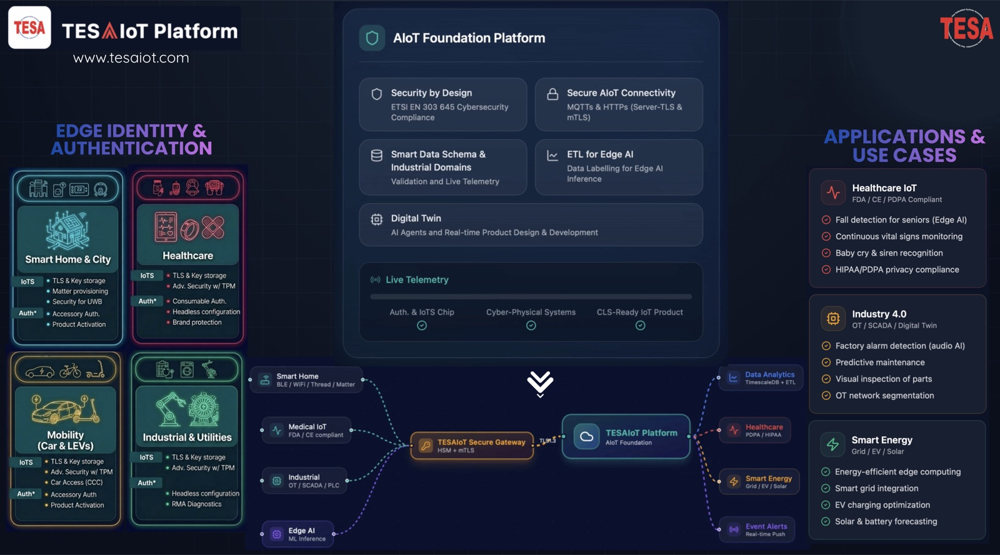
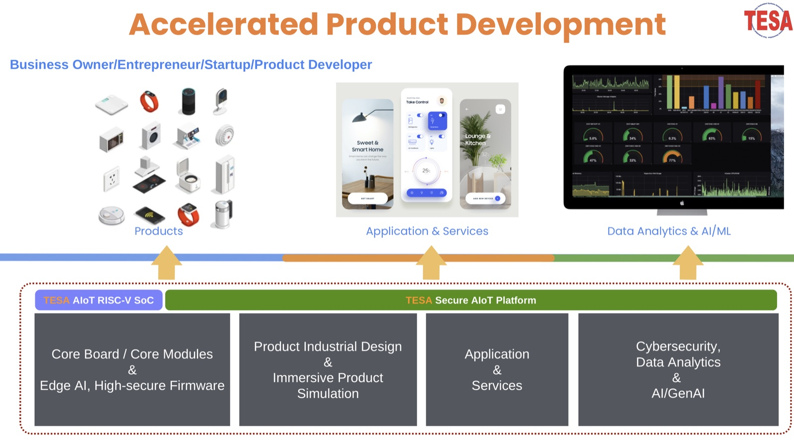

<p align="center">
  
</p>

<h1 align="center">TESAIoT Foundation</h1>

<p align="center">
  <b>Secure · Intelligent · Connected</b><br>
  From secure Edge AI hardware to real-world solutions, by the Thai Embedded Systems Association (TESA)<br>
  จากฮาร์ดแวร์ Edge AI ที่ปลอดภัย สู่โซลูชันที่ใช้งานได้จริง โดยสมาคมสมองกลฝังตัวไทย (TESA)
</p>

<p align="center">
  <a href="https://www.tesaiot.com"></a>
  <a href="https://tesaiot.github.io/tesaiot-pse84-devkit-sdk/"></a>
  <a href="https://tesaiot.github.io/developer-hub/"></a>
  <a href="https://www.tesa.or.th"></a>
  <a href="https://www.linkedin.com/company/93718897"></a>
</p>

<p align="center"><b>Choose your language · เลือกภาษา</b><br><sub>Click a heading below to open or close it · กดที่หัวข้อด้านล่างเพื่อเปิดหรือปิด</sub></p>

<details open>
<summary><h2>🇬🇧 English</h2></summary>

### What we build

TESAIoT is an open, end-to-end AIoT foundation for products that must be secure from the first line of firmware: device identity, encrypted connectivity, Edge AI on the device and analytics in the cloud. It is designed for regulated industries and mission-critical systems, and ready for cybersecurity labelling (CLS, ETSI EN 303 645).

It is built in Thailand, documented in Thai and English, and open source under Apache-2.0 wherever TESA wrote the code.

<p align="center">
  
</p>

| Layer | What it gives you |
|---|---|
| **1 · AIoT Foundation** | AIoT SoM and BSP (ModusToolbox, Zephyr OS, MicroPython), a secure firmware stack that is CLS-ready, DEEPCRAFT Studio for Edge AI models, Digital Twin Studio, and a secure Edge AI data platform |
| **2 · Core modules and product development** | TESAIoT Dev Kit, IoT gateway, BCU/BMS, actuators, the Ternion Digital Twin Studio and enterprise cloud |
| **3 · Commercial scaling** | Healthcare, LEV and energy, service robotics, critical infrastructure and creative industries |

### Start here: our open repositories

| Repository | What it is | Start with |
|---|---|---|
| [**tesaiot-pse84-devkit-sdk**](https://github.com/tesaiot/tesaiot-pse84-devkit-sdk) | Firmware stack and SDK for the Infineon PSoC™ Edge E84: ModusToolbox and ModusToolbox + MicroPython project templates, C examples, API reference, and firmware tested on real boards. | [Docs](https://tesaiot.github.io/tesaiot-pse84-devkit-sdk/) · [Latest firmware](https://github.com/tesaiot/tesaiot-pse84-devkit-sdk/releases/latest) |
| [**tesaiot-community-edition**](https://github.com/tesaiot/tesaiot-community-edition) | A free, self-hostable secure IoT platform for one organization: Vault PKI device identity (server-TLS and mTLS), EMQX MQTT broker, APISIX gateway, MongoDB + TimescaleDB telemetry. One-command Docker Compose install. | [Overview](https://www.tesaiot.com/#community-edition) |
| [**developer-hub**](https://github.com/tesaiot/developer-hub) | One hub across the whole stack: firmware on the MCU, middleware on the edge, web applications in the browser. Remix any example and ship. | [Open the hub](https://tesaiot.github.io/developer-hub/) |
| [**tesa-qualification-program**](https://github.com/tesaiot/tesa-qualification-program) | TESA Open Knowledge: open learning material for embedded systems, AIoT and Edge AI, and the TESA Qualification Program (TESA × Infineon). | [Course site](https://tesaiot.github.io/tesa-qualification-program/) |

### TESAIoT Dev Kit: hardware and the firmware that runs on it

A three-core Edge AI board, shipped with its whole firmware as an open SDK. It boots to a touch menu, reads every sensor, runs MicroPython, talks TLS to the cloud and runs an Edge AI model on the NPU.

- **Silicon:** Cortex-M55 at 400 MHz with Helium and an Ethos-U55 NPU, plus 2 × Cortex-M33 with TrustZone. Wi-Fi 6 and BLE. 4.3" touch display.
- **Security:** an OPTIGA™ Trust M hardware root of trust, secure boot, HSM-backed device identity, and mTLS where the private key never leaves the silicon.
- **Open source:** about 237,000 lines of C and 60+ public APIs, with 31 C examples in the tree.
- **Documentation:** 838 pages in Thai and English.
- **Two ways to build:** pure C with ModusToolbox, or C + MicroPython. Same libraries, same board.

```bash
git clone https://github.com/tesaiot/tesaiot-pse84-devkit-sdk.git
cd tesaiot-pse84-devkit-sdk/bento-firmware-template-mtb-mpy   # or bento-firmware-template-mtb-only
./setup.sh --build      # checks the toolchain first, then builds
make program            # then unplug USB fully, wait ten seconds, plug back in
```

Each firmware release publishes its `.hex` with a SHA-256 checksum: the same file we flash on our own test boards.

### The AIoT Foundation Platform

<p align="center">
  
</p>

- **Security by design:** ETSI EN 303 645 cybersecurity compliance, a 4-tier PKI with automated certificate issuance and renewal, and HSM key protection.
- **Secure AIoT connectivity:** MQTTs and HTTPS with server-TLS or mTLS, plus hardware-based onboarding with the Infineon OPTIGA™ Trust M factory certificate.
- **Smart data:** schemas for industrial domains, validated live telemetry, and ETL with data labelling for Edge AI.
- **Digital Twin:** real-time product design and development on the device's live data.

<p align="center">
  
</p>

### Where it is used

| | |
|---|---|
| **Healthcare IoT** | Fall detection for seniors on the edge, vital-signs monitoring, baby cry and siren recognition, PDPA-aware data handling |
| **Industry 4.0** | Factory alarm detection with audio AI, predictive maintenance, visual inspection, OT network segmentation |
| **Smart energy** | Energy-efficient edge computing, grid integration, EV charging optimization, solar and battery forecasting |
| **Smart home and city** | TLS and key storage on the device, Matter provisioning, accessory authentication, product activation |
| **Mobility** | Cars and light electric vehicles: advanced security with a TPM, car access, accessory authentication |

<p align="center">
  
</p>

### Learn with us

- **Video course:** 28 episodes, about 4 hours 18 minutes, recorded on real hardware: the platform overview, getting firmware onto the board, the Digital Twin, and the BitStream Studio course. See [tesaiot.com](https://www.tesaiot.com).
- **TESA Qualification Program:** open courseware for embedded systems, AIoT and Edge AI. See [tesa-qualification-program](https://tesaiot.github.io/tesa-qualification-program/).
- **Developer Hub:** examples across firmware, middleware and the web. See [developer-hub](https://tesaiot.github.io/developer-hub/).

### License and contact

Source written by TESA is released under the **Apache License 2.0**. A small number of third-party libraries keep their own licences; each repository names them.

Website: [www.tesaiot.com](https://www.tesaiot.com) · [www.tesa.or.th](https://www.tesa.or.th) · Email: [contact@tesa.or.th](mailto:contact@tesa.or.th)

</details>

<details>
<summary><h2>🇹🇭 ภาษาไทย</h2></summary>

### เราสร้างอะไร

TESAIoT คือแพลตฟอร์มพื้นฐาน AIoT แบบเปิด ครบตั้งแต่ต้นจนจบ สำหรับผลิตภัณฑ์ที่ต้องปลอดภัยตั้งแต่เฟิร์มแวร์บรรทัดแรก ได้แก่ การยืนยันตัวตนของอุปกรณ์ การเชื่อมต่อแบบเข้ารหัส Edge AI บนตัวอุปกรณ์ และการวิเคราะห์ข้อมูลบนคลาวด์ ออกแบบมาสำหรับอุตสาหกรรมที่มีข้อกำกับและระบบที่ต้องทำงานโดยไม่มีวันล้มเหลว และพร้อมสำหรับฉลากความมั่นคงปลอดภัยไซเบอร์ (CLS, ETSI EN 303 645)

พัฒนาในประเทศไทย มีเอกสารทั้งภาษาไทยและภาษาอังกฤษ และเปิดซอร์สภายใต้สัญญาอนุญาต Apache-2.0 ในทุกส่วนที่ TESA เป็นผู้เขียน

<p align="center">
  
</p>

| ชั้น | สิ่งที่ได้ |
|---|---|
| **1 · ฐาน AIoT** | AIoT SoM และ BSP (ModusToolbox, Zephyr OS, MicroPython), ชุดเฟิร์มแวร์ที่ปลอดภัยและพร้อมขอฉลาก CLS, DEEPCRAFT Studio สำหรับสร้างโมเดล Edge AI, Digital Twin Studio และแพลตฟอร์มข้อมูล Edge AI ที่ปลอดภัย |
| **2 · โมดูลหลักและการพัฒนาผลิตภัณฑ์** | TESAIoT Dev Kit, IoT Gateway, BCU/BMS, ตัวขับเคลื่อนอัจฉริยะ, Ternion Digital Twin Studio และคลาวด์สำหรับองค์กร |
| **3 · ขยายสู่เชิงพาณิชย์** | การแพทย์ ยานยนต์ไฟฟ้าขนาดเล็กและพลังงาน หุ่นยนต์บริการ โครงสร้างพื้นฐานสำคัญ และอุตสาหกรรมสร้างสรรค์ |

### เริ่มต้นที่คลังโค้ดเปิดของเรา

| คลัง | คืออะไร | เริ่มที่ |
|---|---|---|
| [**tesaiot-pse84-devkit-sdk**](https://github.com/tesaiot/tesaiot-pse84-devkit-sdk) | ชุดเฟิร์มแวร์และ SDK สำหรับ Infineon PSoC™ Edge E84: เทมเพลตโปรเจกต์ ModusToolbox และ ModusToolbox + MicroPython ตัวอย่างภาษา C เอกสาร API และเฟิร์มแวร์ที่ทดสอบบนบอร์ดจริงแล้ว | [เอกสาร](https://tesaiot.github.io/tesaiot-pse84-devkit-sdk/) · [เฟิร์มแวร์ล่าสุด](https://github.com/tesaiot/tesaiot-pse84-devkit-sdk/releases/latest) |
| [**tesaiot-community-edition**](https://github.com/tesaiot/tesaiot-community-edition) | แพลตฟอร์ม IoT ที่ปลอดภัย ใช้ฟรี ติดตั้งเองได้สำหรับหนึ่งองค์กร: ระบุตัวตนอุปกรณ์ด้วย Vault PKI (server-TLS และ mTLS), EMQX MQTT broker, APISIX gateway, เก็บข้อมูลด้วย MongoDB + TimescaleDB ติดตั้งด้วย Docker Compose คำสั่งเดียว | [ภาพรวม](https://www.tesaiot.com/#community-edition) |
| [**developer-hub**](https://github.com/tesaiot/developer-hub) | ศูนย์รวมนักพัฒนาที่ครอบคลุมทุกชั้น: เฟิร์มแวร์บน MCU มิดเดิลแวร์บนอุปกรณ์ปลายทาง และเว็บแอปในเบราว์เซอร์ นำตัวอย่างไปดัดแปลงต่อได้ทันที | [เปิด Developer Hub](https://tesaiot.github.io/developer-hub/) |
| [**tesa-qualification-program**](https://github.com/tesaiot/tesa-qualification-program) | TESA Open Knowledge: คลังความรู้เปิดด้านระบบสมองกลฝังตัว AIoT และ Edge AI และหลักสูตร TESA Qualification Program (TESA × Infineon) | [เว็บหลักสูตร](https://tesaiot.github.io/tesa-qualification-program/) |

### TESAIoT Dev Kit: ฮาร์ดแวร์และเฟิร์มแวร์ที่รันอยู่บนบอร์ดจริง

บอร์ด Edge AI สามคอร์ ที่มาพร้อมเฟิร์มแวร์ทั้งหมดในรูป SDK แบบเปิด เปิดเครื่องแล้วขึ้นเมนูแบบสัมผัส อ่านเซนเซอร์ได้ทุกตัว รัน MicroPython เชื่อมคลาวด์ผ่าน TLS และรันโมเดล Edge AI บน NPU

- **ชิป:** Cortex-M55 400 MHz พร้อม Helium และ NPU Ethos-U55 กับ Cortex-M33 อีก 2 คอร์ที่มี TrustZone, Wi-Fi 6 และ BLE, จอสัมผัส 4.3 นิ้ว
- **ความปลอดภัย:** ใช้ OPTIGA™ Trust M เป็นรากฐานความเชื่อถือระดับฮาร์ดแวร์ มี secure boot และตัวตนอุปกรณ์ที่ผูกกับ HSM ส่วน mTLS ใช้กุญแจส่วนตัวที่ไม่เคยออกจากชิป
- **โค้ดเปิด:** ภาษา C ประมาณ 237,000 บรรทัด API สาธารณะมากกว่า 60 ตัว และตัวอย่างภาษา C 31 ตัวในคลัง
- **เอกสาร:** 838 หน้า ทั้งภาษาไทยและอังกฤษ
- **build ได้สองแบบ:** ภาษา C ล้วนด้วย ModusToolbox หรือ C ร่วมกับ MicroPython ใช้ไลบรารีชุดเดียวกัน บนบอร์ดเดียวกัน

```bash
git clone https://github.com/tesaiot/tesaiot-pse84-devkit-sdk.git
cd tesaiot-pse84-devkit-sdk/bento-firmware-template-mtb-mpy   # หรือ bento-firmware-template-mtb-only
./setup.sh --build      # ตรวจเครื่องมือก่อน แล้วจึง build
make program            # จากนั้นถอดสาย USB ออกจนสุด รอสิบวินาที แล้วเสียบใหม่
```

เฟิร์มแวร์ทุกรุ่นเผยแพร่ไฟล์ `.hex` พร้อมค่า SHA-256 เป็นไฟล์เดียวกับที่เราแฟลชลงบอร์ดทดสอบของเราเอง

### AIoT Foundation Platform

<p align="center">
  
</p>

- **ปลอดภัยตั้งแต่การออกแบบ:** สอดคล้องมาตรฐาน ETSI EN 303 645, PKI 4 ชั้นที่ออกและต่ออายุใบรับรองอัตโนมัติ และปกป้องกุญแจด้วย HSM
- **เชื่อมต่ออย่างปลอดภัย:** MQTTs และ HTTPS แบบ server-TLS หรือ mTLS และลงทะเบียนอุปกรณ์ด้วยใบรับรองจากโรงงานของ Infineon OPTIGA™ Trust M
- **ข้อมูลอัจฉริยะ:** โครงสร้างข้อมูลสำหรับอุตสาหกรรมต่าง ๆ ข้อมูลเทเลเมทรีสดที่ผ่านการตรวจสอบ และ ETL พร้อมการติดป้ายข้อมูลสำหรับ Edge AI
- **Digital Twin:** ออกแบบและพัฒนาผลิตภัณฑ์แบบเรียลไทม์บนข้อมูลสดจากอุปกรณ์

<p align="center">
  
</p>

### นำไปใช้ที่ไหนได้บ้าง

| | |
|---|---|
| **IoT การแพทย์** | ตรวจจับการล้มของผู้สูงอายุบนตัวอุปกรณ์ ติดตามสัญญาณชีพต่อเนื่อง จดจำเสียงเด็กร้องและเสียงไซเรน จัดการข้อมูลตาม PDPA |
| **อุตสาหกรรม 4.0** | ตรวจจับเสียงสัญญาณเตือนในโรงงานด้วย AI เสียง บำรุงรักษาเชิงคาดการณ์ ตรวจชิ้นงานด้วยภาพ แบ่งส่วนเครือข่าย OT |
| **พลังงานอัจฉริยะ** | ประมวลผลที่ปลายทางอย่างประหยัดพลังงาน เชื่อมต่อโครงข่ายไฟฟ้า จัดการการชาร์จรถไฟฟ้า พยากรณ์พลังงานแสงอาทิตย์และแบตเตอรี่ |
| **บ้านและเมืองอัจฉริยะ** | TLS และการเก็บกุญแจบนอุปกรณ์ ลงทะเบียน Matter ยืนยันตัวตนอุปกรณ์เสริม เปิดใช้งานผลิตภัณฑ์ |
| **การเดินทาง** | รถยนต์และยานยนต์ไฟฟ้าขนาดเล็ก: ความปลอดภัยขั้นสูงด้วย TPM ระบบเข้าถึงรถ ยืนยันตัวตนอุปกรณ์เสริม |

<p align="center">
  
</p>

### เรียนรู้ไปกับเรา

- **คอร์สวิดีโอ:** 28 ตอน ยาวประมาณ 4 ชั่วโมง 18 นาที ถ่ายทำกับฮาร์ดแวร์จริง ได้แก่ ภาพรวมแพลตฟอร์ม การลงเฟิร์มแวร์บนบอร์ด Digital Twin และคอร์ส BitStream Studio ดูได้ที่ [tesaiot.com](https://www.tesaiot.com)
- **TESA Qualification Program:** สื่อการเรียนแบบเปิดด้านระบบสมองกลฝังตัว AIoT และ Edge AI ดูได้ที่ [tesa-qualification-program](https://tesaiot.github.io/tesa-qualification-program/)
- **Developer Hub:** ตัวอย่างครอบคลุมเฟิร์มแวร์ มิดเดิลแวร์ และเว็บ ดูได้ที่ [developer-hub](https://tesaiot.github.io/developer-hub/)

### สัญญาอนุญาตและการติดต่อ

ซอร์สโค้ดที่ TESA เป็นผู้เขียนเผยแพร่ภายใต้ **Apache License 2.0** ไลบรารีของบุคคลภายนอกจำนวนหนึ่งใช้สัญญาอนุญาตของตนเอง ซึ่งแต่ละคลังระบุไว้แล้ว

เว็บไซต์: [www.tesaiot.com](https://www.tesaiot.com) · [www.tesa.or.th](https://www.tesa.or.th) · อีเมล: [contact@tesa.or.th](mailto:contact@tesa.or.th)

</details>

<p align="center"><sub>Together, we build a smarter, safer and more connected future. · ร่วมกันสร้างอนาคตที่ฉลาดขึ้น ปลอดภัยขึ้น และเชื่อมต่อกันมากขึ้น</sub></p>
